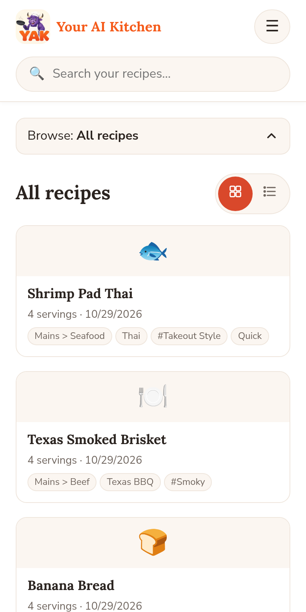
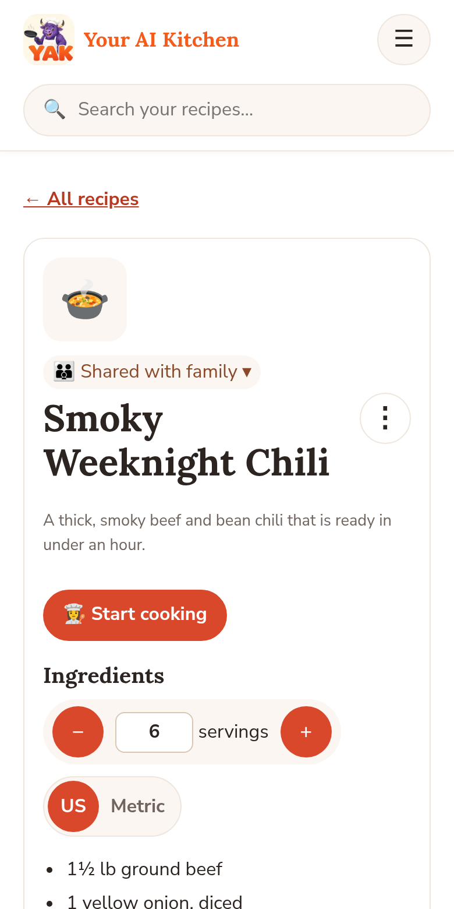
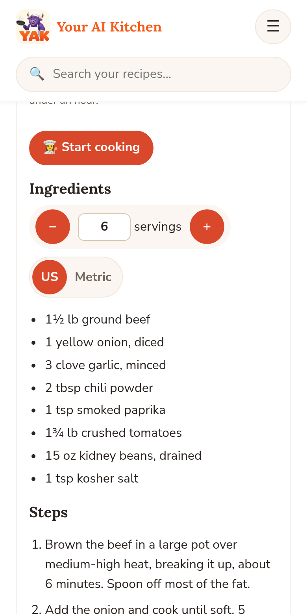

# Your AI Kitchen (YAK)

*Family makes the memories. We just save the ingredients.*

Your AI Kitchen is a recipe box that lives inside the AI chat you already use. Ask ChatGPT or Grok to save a recipe, scale it, plan the week's dinners or build a shopping list, and it all lands in your own recipe box at [youraikitchen.com](https://youraikitchen.com).

This repository is for information only. It holds no app code. YAK is a hosted service.

## Connect

**Server URL:** `https://youraikitchen.com/mcp`
**Transport:** Streamable HTTP · **Sign-in:** OAuth (you sign in to your YAK account; nothing to copy or paste)

**ChatGPT Plus** (chatgpt.com, in a web browser)
1. Open **Plugins**, click **+** → **Add custom MCP server**.
2. Name it **Your AI Kitchen**, paste the URL, choose **OAuth**.
3. Tick **I understand and want to continue**, click **Create**, then sign in and **Allow**.

**Grok** (grok.com)
1. Go to **grok.com/connectors**.
2. Click **New Connector** → **Custom**, paste the URL.
3. Sign in to Your AI Kitchen and **Allow**.

Then try: *"Save my chili recipe to Your AI Kitchen."*

## What it can do (21 tools)

| Tool | What it does |
|---|---|
| `save_recipe` | Save a recipe (pasted, imported or from the chat) |
| `start_recipe_draft` | Create a new recipe with you, one question at a time, as a live draft |
| `update_recipe` | Edit a recipe or draft; history is kept |
| `finalize_recipe` | File a finished draft as a saved recipe |
| `get_recipe` | Open a recipe, scaled to any servings, in US or metric units |
| `search_recipes` | Find your recipes |
| `suggest_dishes` | Suggest dishes for a vague idea, cuisine or occasion |
| `delete_recipe` | Move to trash, restore, or delete for good |
| `convert_units` | Convert a measurement, using ingredient density (e.g. cups of flour to grams) |
| `get_nutrition` | Estimated nutrition per serving (USDA data) |
| `set_recipe_image` | Add a dish photo (Chef plan) |
| `import_from_url` | Read a recipe from a web page link |
| `manage_categories` | Manage filing categories |
| `manage_family` | Family group, members, invites and plan |
| `list_history` | See who changed a recipe, what and when |
| `restore_revision` | Undo a recipe change |
| `manage_menu` | Save and edit weekly, daily or occasion menus |
| `plan_menu` | Suggest a menu from your saved and shared recipes |
| `shopping_list` | Make a shopping list from a menu, sorted by aisle |
| `share_with_family` | Share a recipe, menu or list with your group |
| `hide_shared` | Hide something shared with you, from your view only |

## Plans

Paid, with a 14-day free trial (card required). No free tier.

| Plan | Price | Includes |
|---|---|---|
| Home Cook | $2.99/month | Up to 250 recipes |
| Family | $9.47/month | Unlimited recipes, share with up to 5 people |
| Chef | $18.99/month | Unlimited recipes, groups, dish photos |

## Screenshots

  

## Links

- Website: https://youraikitchen.com
- Web app: https://youraikitchen.com/app/
- Privacy: https://youraikitchen.com/privacy
- Terms: https://youraikitchen.com/terms
- Support: support@youraikitchen.com
- MCP Registry: `com.youraikitchen/yak`
